# Monitoring Algolia with Datadog

[Algolia](https://www.algolia.com/) is a proprietary search engine available as
a SaaS, and [Datadog](https://www.datadoghq.com/) is a cloud monitoring
service, also available as a SaaS.

At ManoMano, we use Algolia as a search engine, and we use Datadog for all our
observability purposes. Algolia is a critical piece of our infrastructure, and
needs to be monitored closely. Let me show you how we do it, because there are
a few functional gaps that make this integration not completely straightforward.

At the time of writing this post, there is no official integration between
Algolia and Datadog. The following links show nothing:

- https://docs.datadoghq.com/integrations/?q=algolia
- https://www.algolia.com/doc/integration

I will update this blog post if this ever changes.

## Integrating the usage API with Datadog

Algolia has a [usage API](https://www.algolia.com/doc/rest-api/usage) that
powers their dashboard, and that they documented so it can be used by their
clients as well.

Algolia has a concept of application, which is a top-level container for your
indices. Think of it like a database, but for search indices rather than SQL
tables. We leverage those to regroup our indices because ManoMano is available
in 5 countries, it's available to businesses or individuals, and we have 2
several environments besides production.

Sadly, Algolia does not provide a global overview accross our 30 apps of what
it exposes in its usage API.

Also, even if you have a single app, the dashboard exposes an overview showing
e.g. how much traffic your app receives overall, but not a breakdown per index.
If you want to know which index receives the most traffic, you have to go on the
statistics page of every index.

Datadog on the other hand is an observability tool with best-in-class
experience, and by providing this usage API, Algolia allows you to leverage it,
and build dashboards that fit your needs.

Here is the kind of breakdown you can get as a final result:

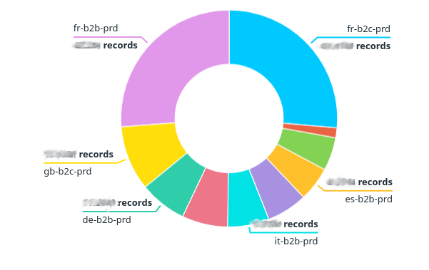

One key thing to realize with this API, and this is not documented last I
checked, is that two successive calls can return different results.

More precisely, even if you use the smallest possible time window, which
corresponds to hourly granularity, the results might be incomplete. On our
applications, I can see the data for the 2 last hours evolve.

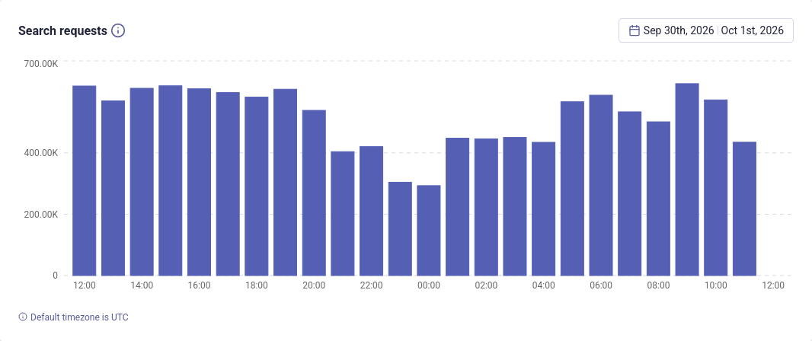
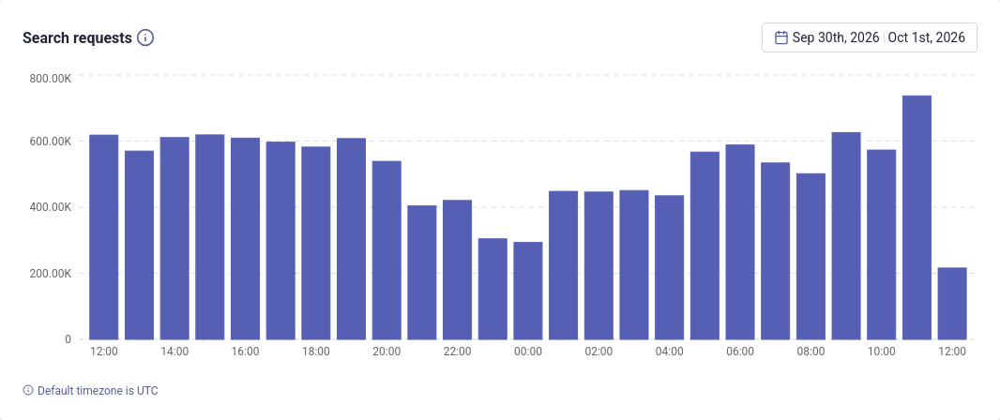

Also, when you ask for hourly granularity, you always get 25 data points. For
instance, right now it is 14:02 here, and I get one data point for yesterday
14:00, another for yesterday 15:00, and so on, until today 14:00. Right now,
today 14:00 reports 0 queries, but you can be sure that in a few minutes, this
figure will jump higher, and it keeps jumping higher until reaching its final
value. The 25 data points are mutable.

So the usage API is really geared towards powering the dashboard, but is
perhaps not the most convenient for other usages.

<details>
<summary>Skip this if you already know what counters and gauges are</summary>
Datadog supports several types of metrics and the most prominent are gauges
and counters. The typical example you will see for gauges is the temperature:
it evolves over time but you do not need to sum temperature over a time range,
that would make no sense at all.
Algolia-specific examples are the data size of an app,
or the number of records in a given index.
Counters, on the other hand, are metrics on which you need to be precise,
because you can aggregate them: you can compute the number of requests on a day
just by knowing the number of requests over an hour. If the metrics are used in
the formula that drives your
budget, it is important to get them right. 💰
</details>

With Datadog, you can only send a metric for the current time, unless you are
ready to go through [some hoops](https://docs.datadoghq.com/fr/metrics/custom_metrics/historical_metrics).
So if your plan to work around the mutable data point issue is to assume that
the data for t - 2h is always complete, you will send a metric that is at least
2 hours late. Not great if you are trying to correlate incidents with metrics
from Algolia. Also, you have to be careful to run your program at the right
frequency so that you report that figure only once per hour.

So to get things right, we ended up resorting to a diffing strategy: we run a
cronjob every 5 minutes, and when it comes to counters, that cronjob goes
through the following steps:

1. It retrieves the response stored by the last run on a shared storage (S3 in our case).
2. It compares the new response with the old one.
3. If it sees a difference, it sends the difference to Datadog (for the current
   time, which I believe is the only option, as previously said).
4. Whatever happens, it stores the new response regardless.

The result is shown below:

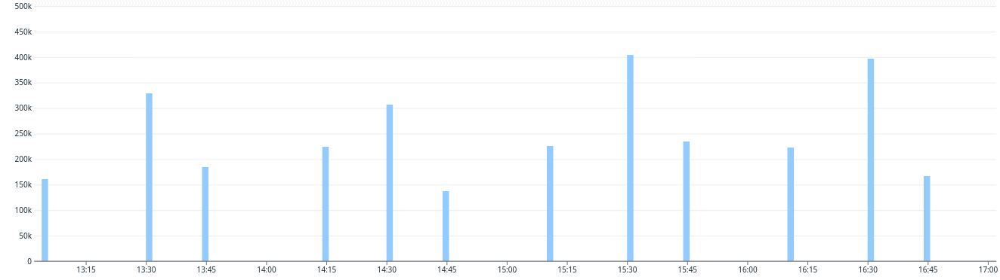

As you can see, the graph does not update very frequently, and there is no
clear pattern on when we should expect an update. The cronjob runs every 5
minutes, which is why the datapoints are all emitted on multiple of 5 minutes,
it does not mean the graph updated at exactly that time. So the graph is
sparse, it is late, but if you take a big enough timeframe, it becomes
valuable.

It did not feel great having to do this at first, but I could not find another
solution, and in the end, when comparing Algolia's dashboards and Datadog's, I
ended up with the exact same figures. Pretty cool, right?

## Adding an event overlay

Datadog comes with a cool feature called the event overlay. It allows you to
show so-called Datadog events on top of any graph, as vertical bars.

When investigating an incident, it can be very helpful to have an overlay
showing when relevant projects got deployed, or relevant A/B tests were
started, and you can emit events yourself to achieve this.

In the case of Algolia, we have an overlay showing when our indexer gets
deployed, or when our client projects get deployed.
But we're not the only ones doing work here. The Algolia team also deploys
quite often.
Overall, I would say they have a great track record, but even then, there have
been a few times where having this overlay was very handy to decide whether to
file a support ticket or keep investigating our recent releases.

Moreover, the last SEV-1 my team suffered was caused by a latent bug in
our code that was revealed by an Algolia deploy. Knowing about that deploy and
filing a ticket asking them to rollback was one way we could have mitigated
that incident.

Here is how such an overlay can look:

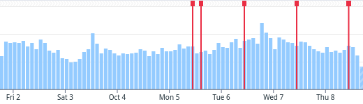

To achieve this, I've been relying on
`https://my-app-id.algolia.net/1/version`. Careful again here, that API is not
documented, but it has been working for quite a while now. If it gets removed,
I guess we will just have a small incident that we will fix by dropping the
feature.

The idea is simple, and relies on storage again: every 5 minutes, fetch the
value, compare with what you have previously stored, and if it changes, fire a
Datadog event.


## Measuring lag

When filing a support ticket with Algolia, you have to choose between the
following priorities:

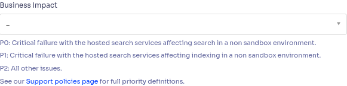

As you can see, once the search API is working, your next worry should be the
indexing. But how do you know it is working?

Let us say your indexing program works perfectly: you have zero lag on your
indexing queue, and no errors when calling Algolia. That's not a guarantee that
your updates are visible yet: Algolia has its own internal queue, so unless you
use [wait for task](https://www.algolia.com/doc/libraries/sdk/methods/search/wait-for-task#usage)
on each and every update you send, you won't know if there is Lag.

To be clear, I do not recommend waiting for your updates, especially if like me,
you send hundreds of millions of them a day. If you want to know the lag of the
internal queue, you can visit `/monitoring/performance` in your dashboard.

You should see something like this:

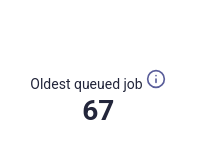

That looks like a very useful metric to monitor. Sadly, it's not exposed in the
usage API. It's possible to get it with an API call, but authenticating with
that API is not documented and seems to rely on cookies, which, in my case,
involve a complex authentication scheme with SSO. Something clearly not geared
towards automated use.

If, like me, you have an index that  continously receives updates, and bumps a
timestamp with each update, you can use a neat algorithm to approximate that
with not too many calls to the browse API.

What's great is that it will catch an issue on Algolia's side, but it can also
catch a lag on your own system. It's a very good end to end test. The downside
is a downside you find with most end to end tests: it does not tell you which
part is responsible for the lag. Still, it's a very reliable signal that
something is very wrong.

In Golang-ish pseudo code, it goes like this:

```
timestamp = now
// you should start by picking the power of 2 that is the closest to the most
// likely value of the lag. In my case it's 2 minutes, so the closest power of 2
// is 128
interval = 128

// First loop to find a lower bound for the lag
//
//************************** <-- updates we are looking for
//----------------------------------------------------0--> time
//                                                   XX
//                                                 XX
//                                             XXXX
//                                     XXXXXXXX
//                    XXXXXXXXXXXXXXXXX
for {
   // In practice, we also check all the intervals we already checked, since we
   // do not specify an upper bound. However since they are empty, there is no
   // harm in doing that.
   if index.hasResultsAfterTimestamp(timestamp) {
      break
   }

   // look left to the interval we just checked
   timestamp -= interval
   // next time, let us check in an interval that is twice as big
   interval *= 2
}

// At this point, we found results: timestamp is a lower bound for the latest update,
// so now - timestamp allows us to compute an upper bound for the lag.

previousLowerBound := timestamp

// Second loop, we need to bisect the interval we found
// That is just a fancy word to say: slice the interval in 2, and determine
// whether the update we are looking for is on the left or in the right interval
//
//************************** <-- updates we are looking for
//----------------------------------------------------0--> time
//                             XXXXXXXX
//                         XXXX
//                           XX
//                          X

for {
   interval /= 2
   if interval < 1 {
      break
   }

   timestamp = previousLowerBound + interval
   if index.hasResultsAfterTimestamp(timestamp) {
      // it's in the right part!
      previousLowerBound = timestamp
   }

   // if it is in the left part, let us stick with the current previousLowerBound
   // nothing to change here
}

return now - timestamp
```

I love that algorithm! It goes like zoom out, zoom out, zoom out, and then
zoom in, zoom in, zoom in.

Here is what the end result looks like during an indexing incident:

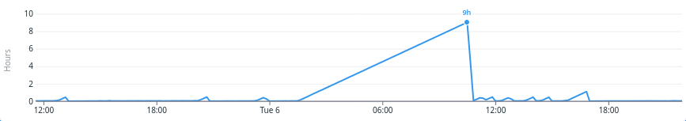

Unmistakably incident worthy. I love it because this will never give you a
false positive, if like for us, updates are supposed to be received continuously.

## Synthetics Monitoring

This Datadog feature allows us to send the exact same Algolia query at regular
intervals. This way, if there is a latency increase, it helps us determine if
the issue is caused by a deploy on our side, or if it is an issue with Algolia.

You should first define a request. Make sure to set `analytics` to `false`.

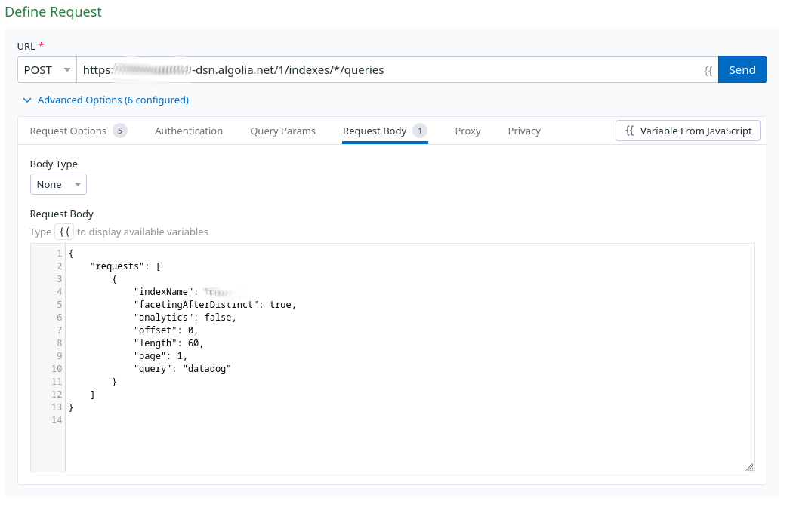

Then, you should define assertions on the response.

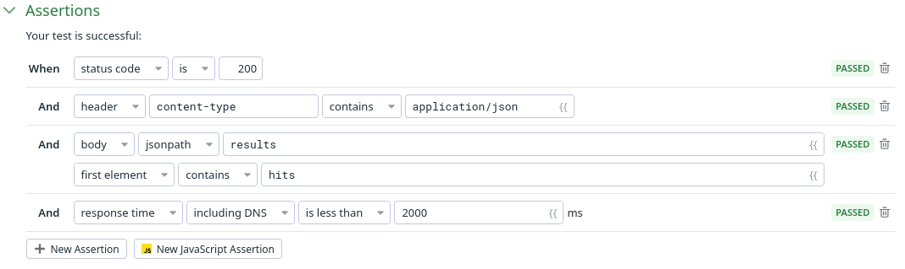

You also get a history of the calls and how long they took, and you can see a
breakdown of the duration by step: DNS resolution, TLS handshake, time to first
byte, etc.

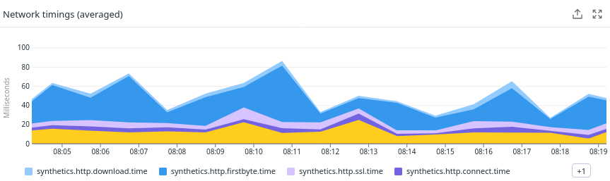

I also file it in my head under "tests whose alerts you should absolutely not
ignore".

## Summary

- Keep your own copy of the metrics, and use a dedicated tool to build
  dashboards with that.
- Keep track of Algolia's deploys, so as to correlate incidents.
- Monitor the indexing by keeping track of the lag.
- Monitor the latency and availability with Synthetics.
- When your system get complex enough and your observability leaves you in the
dark, check your provider's APIs: even if your provider does not expose
the dashboards you need, they might give you the building blocks to create it
yourself.
